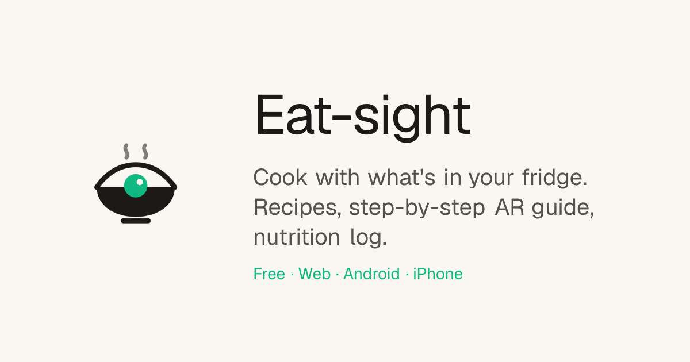

  

<h1 align="center">Eat-sight</h1>

  <b>See what you can cook with what's already in your fridge.</b> 
  Free · No account needed · Web, Android, iPhone, iPad, desktop

  <a href="https://eat-sight.vercel.app"><b>Open the app</b></a> ·
  <a href="https://eat-sight.vercel.app/download">Install guide</a> ·
  <a href="https://eat-sight.vercel.app/downloads/eat-sight.apk">Android APK</a> ·
  <a href="../../issues/new/choose">Send feedback</a>

---

## Why

Living alone, I kept throwing away half-used vegetables because I never knew what to make with them. Eat-sight starts from **your** fridge and **your** kitchen, not from a recipe you'd need to shop for.

## Features

- **Fridge → recipes.** Add what you have, with use-by dates. See recipes you can make *right now*, plus ones that are only 1–2 ingredients away.
- **Matches your kitchen.** No oven, no air fryer? Recipes are filtered by the tools you actually own.
- **Step-by-step cooking guide** with timers.
- **Servings dial (1–10).** Ingredients rescale sensibly: spices and water don't scale linearly, and cooking times adjust too.
- **Leftovers remake.** Turn last night's takeout into a new dish.
- **Meal & nutrition log.** Log by picking, typing or snapping a photo. See fiber, sodium, vitamins, what you're short on today and foods that fill the gap.
- **Diet, allergy & health aware.** Vegetarian or vegan diets, allergies and health conditions are applied everywhere.
- **Use-by alerts** so food gets eaten before it goes bad.
- **Languages:** English, 日本語, 中文, 한국어

## Get it

| Device | How |
|---|---|
| **Any browser** | Open **https://eat-sight.vercel.app** |
| **Android** | Download the [APK](https://eat-sight.vercel.app/downloads/eat-sight.apk) (test build before the Play Store release). See the [install guide](https://eat-sight.vercel.app/download) for the "unknown apps" step. |
| **iPhone / iPad** | In Safari, open the [install guide](https://eat-sight.vercel.app/download) and install the profile, or use Share → *Add to Home Screen*. |
| **Mac / Windows** | In Chrome or Edge, open the site and click the install icon in the address bar. |

You can start **without logging in** (your data stays on your device), or sign in with a social account to sync across devices.

## Feedback

This is a solo project and still early. Bug reports, feature ideas and "this confused me" notes are all very welcome: **[open an issue](../../issues/new/choose)**.

## Privacy

See the [privacy policy](https://eat-sight.vercel.app/privacy). You can delete your account and all synced data at any time from the profile menu.

---

This repository is the public home page for Eat-sight (introduction, downloads and feedback). The app's source code is not published here. © Eat-sight. All rights reserved.
